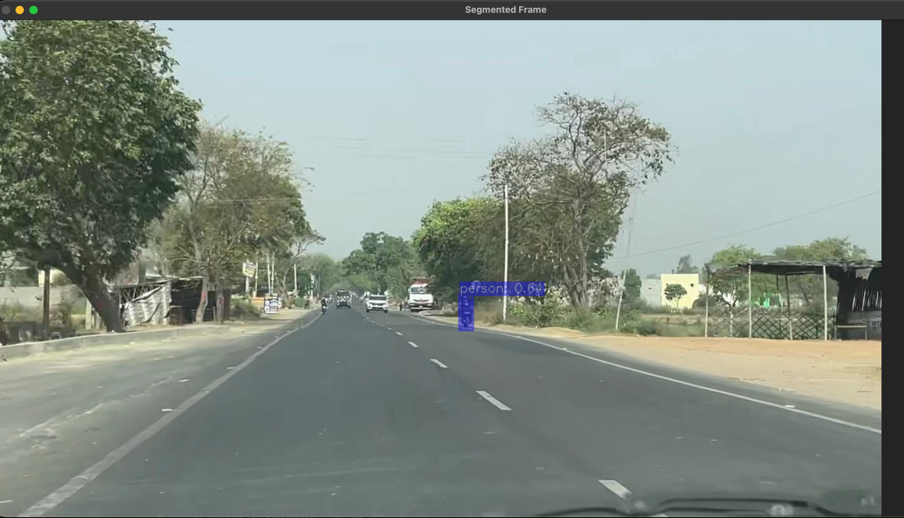
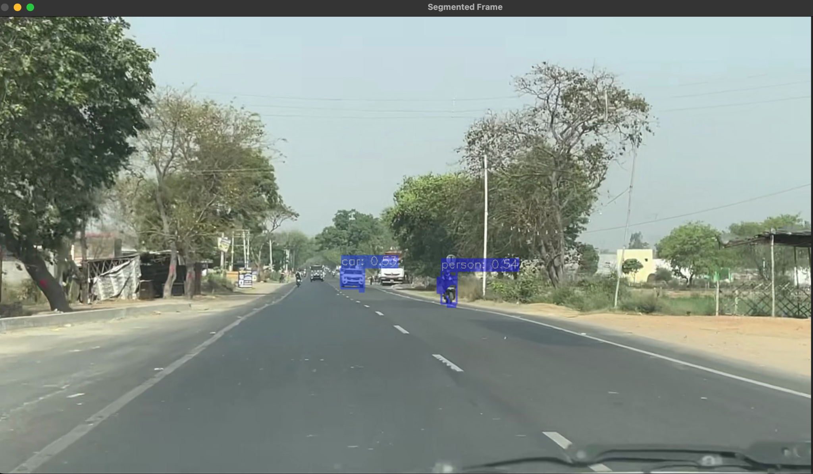
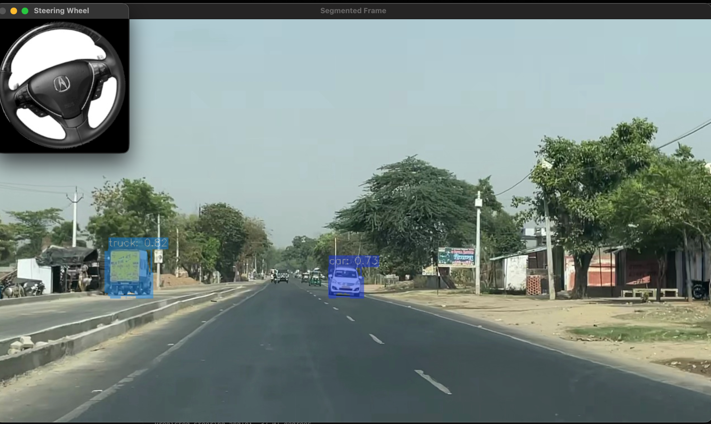

# AI-POWERED OBJECT DETECTION FOR UNSTRUCTURED INDIAN ROAD ENVIRONMENTS

> A portfolio-only showcase of a YOLOv11 computer-vision system for detecting road objects in complex Indian traffic scenes.

This repository contains the project overview and selected qualitative result screenshots. The implementation is intentionally kept private: source code, training data, model weights, checkpoints, notebooks, and internal outputs are not included.

## Project Information

| | |
|---|---|
| Project type | Minor Project-II |
| Submitted by | Mohammad Azain |
| Enrollment No. | 2022-310-118 |
| Supervisor | Mr. Faraz Doja |
| Department | Computer Science & Engineering, Jamia Hamdard, New Delhi |
| Academic session | 2025-2026 |

## Overview

Indian road environments are visually diverse and difficult for standard object-detection systems. Traffic may include cars, trucks, pedestrians, motorcycles, auto-rickshaws, cycle-rickshaws, animals, and other road agents in dense, unstructured scenes.

This project develops a YOLOv11-based detection pipeline specialized for Indian road conditions. The system performs inference on images or video frames, filters detections using confidence and IoU thresholds, draws bounding boxes and labels, and produces statistical summaries of detections and confidence scores.

## Motivation

- Improve perception for region-specific Indian road scenes.
- Recognize road agents that are underrepresented in international datasets.
- Support future ADAS and autonomous-mobility applications.
- Provide visual and statistical evidence for model behavior.

## System Pipeline

```text
Camera image or video frame
            |
            v
       YOLOv11 inference
            |
            v
Confidence filtering + NMS
            |
            v
Bounding boxes, class IDs, and confidence scores
            |
            v
OpenCV visualization + statistics generation
            |
            v
Annotated frame and detection reports
```

## Main Components

- **YOLOv11:** Detects and localizes objects in each road-scene frame.
- **Inference visualizer:** Loads images, runs predictions, draws annotations, and saves outputs.
- **OpenCV:** Handles image input, bounding boxes, labels, and visual output.
- **Matplotlib and Seaborn:** Generate class-count and confidence-distribution plots.
- **NumPy and Pandas:** Support numerical processing and report generation.
- **tqdm:** Displays progress during batch inference.

## Project Objectives

1. Implement a YOLOv11 detector using the Ultralytics framework.
2. Use a dataset specialized for Indian road conditions and uncommon road-agent classes.
3. Target real-time inference performance above 20 FPS on suitable hardware.
4. Target mAP greater than 85% across the 0.5-0.95 IoU range.
5. Produce annotated outputs and statistical reports for transparent evaluation.

## Qualitative Results

### Person detection



### Car and person detection



### Car and truck detection with steering-wheel view



The screenshots demonstrate detection overlays on unstructured road scenes. They are qualitative examples from the project report, not a substitute for a complete benchmark.

## Evaluation Note

The report identifies mAP and inference speed as the primary evaluation metrics and specifies targets of **greater than 85% mAP@0.5-0.95** and **more than 20 FPS**. The supplied report does not state final numeric mAP or FPS values; it contains placeholders for those measurements. This showcase therefore does not claim a final benchmark score.

## Future Work

- Add multi-modal fusion with LiDAR or RADAR.
- Quantize and prune the model for embedded deployment.
- Integrate multi-object tracking such as DeepSORT.
- Add lane segmentation and road-boundary detection.
- Expand testing across lighting, weather, traffic density, and rare road-agent classes.

## Repository Scope

Included:

- This README
- Three representative detection screenshots

Not included:

- Source code
- Dataset images and labels
- Trained model weights
- Classifier checkpoints
- Notebooks and development files

No public repository can technically prevent copying of public text or images. This limited release reduces exposure by sharing the project story and visual evidence without publishing the implementation or training assets.

## Attribution

The screenshots are representative outputs from the author's project report. Any dataset used for training or evaluation should be credited according to its original license and source terms.

